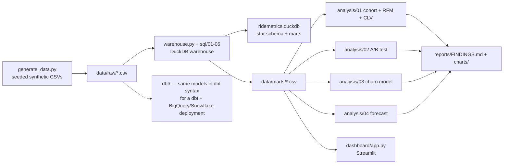

# RideMetrics — Retention, Churn & Experiment Analytics for a DTC Bike Shop

**By Jared Fontaine** — MBA · Google Data Analytics Professional Certificate (2021) · Gorgias Certified Admin & CX · Cycling e-commerce customer experience specialist ($500K+ in curated bike sales at Curated; Planet Cyclery, Cambria Bike, Tune Cycles).

> **Honesty note:** Summit Cycles is a fictional shop and every row here is synthetic, seeded (42) and generated by `data/generate_data.py`. No real client data. The point is the method — the same code runs unchanged on real Shopify / GA4 / Gorgias exports (see "Swap in real data" below).

## The business problem

A direct-to-consumer bike shop does not die from a lack of traffic. It dies from leaky retention: riders buy a bike, have one bad support experience, and never come back — while the team argues about a free-shipping threshold with no test. RideMetrics answers four money questions in one coherent pipeline:

1. **Who stays?** Cohort retention + RFM segmentation + CLV.
2. **What works?** A properly analysed A/B test (free shipping at $75 vs $99).
3. **Who is about to leave?** A leakage-free churn model that scores every customer.
4. **What's next?** A backtested revenue forecast.

## Headline findings (real output, pipeline run end-to-end 2026-11-06)

| Question | Result |
|---|---|
| Revenue in dataset | $19,459,486 across 11,841 orders / 2,500 customers (Jan 2023–Dec 2024) |
| Cohort retention | Month-1 retention **27.9%**, Month-3 **23.7%** (24 monthly cohorts) |
| RFM revenue concentration | **Champions (622 customers) = 40.4% of revenue**; Champions + Loyal = 65.2%. At Risk (355) still hold 17.3% — the cheapest revenue to save |
| CLV | AOV $1,643 (bike-heavy baskets) · avg frequency 4.74 · historical CLV $7,784 · margin-adjusted CLV estimate $2,958 |
| A/B test | Treatment conversion **9.99% vs 8.48% control = +17.7% relative lift**, 95% CI for the difference **[+0.83pp, +2.18pp]**, z = 4.34, **p = 1.4e-05** → **SHIP the $75 threshold**. Revenue/session $10.98 vs $9.47 (p = 0.0007); AOV guardrail $109.91 vs $111.67 (−1.6%, acceptable) |
| Churn model | Predicts *future* 180-day churn from features up to 2024-06-30 (no label leakage): **Logistic Regression AUC 0.773, Random Forest AUC 0.717**. Top drivers: recency, AOV, monetary, tenure, average CSAT, return rate. 559 customers scored High risk |
| Forecast | Backtest MAPE **22.7%** (last 3 months). Next 6 months forecast: **$8.44M**, rising into the Apr–Jun peak ($1.97M in Jun 2025) |

Full methods, limitations and quantified recommendations: [`reports/FINDINGS.md`](reports/FINDINGS.md).

## Stack — mapped to what job postings actually ask for

| Tool / technique | Share of 2025–26 data-analyst postings* | Where it lives here |
|---|---|---|
| SQL — CTEs, window functions, complex joins | 85–94% | `sql/01–06` (NTILE, ROW_NUMBER, RANK, LAG, running totals) |
| Excel-ready flat files | 78–82% | `data/marts/*.csv` — pivot-ready marts |
| Python / pandas | 48–71% | `analysis/`, `data/generate_data.py` |
| Tableau / Power BI | 54–65% | `BI_SPEC.md` (DAX + Tableau calcs to rebuild this dashboard) + Streamlit app |
| Statistics (scipy / statsmodels) | 42–48% | `analysis/02_ab_test.py`, `analysis/04_forecast.py` |
| ETL / ELT | ~41% | `warehouse.py` (DuckDB load + ordered SQL runs) |
| A/B testing | ~37% | `analysis/02_ab_test.py`, `sql/06_ab_test_aggregates.sql` |
| Data modelling (star schema) | ~31–35% | `sql/01_star_schema_build.sql`, `dbt/` |
| dbt (modern transformation layer; 30–50% salary premium with Python) | mainstream / default in modern stacks | `dbt/` — staging + marts with `ref()`/`source()` and schema tests |
| Cloud warehouse pattern (BigQuery / Snowflake / Redshift) | — | DuckDB locally plays the warehouse role; SQL is warehouse-portable |
| scikit-learn ML (churn) | growth area | `analysis/03_churn_model.py` |
| Cohort / RFM / CLV / funnel | core analyst craft | `analysis/01_cohort_rfm.py`, `sql/02–04` |

\*Posting-demand summary from 2025–26 job-market research; full mapping with file paths in [`JOB_MARKET_MAP.md`](JOB_MARKET_MAP.md).

## Architecture



The `sql/` runner is the executable equivalent of the `dbt/` project: same models, two dialects. In production I would run dbt against BigQuery/Snowflake; DuckDB makes this repo runnable anywhere with zero accounts.

## Quickstart

```bash
python -m venv .venv && source .venv/bin/activate
pip install -r requirements.txt
python data/generate_data.py      # ~25s, prints row counts
python warehouse.py               # builds ridemetrics.duckdb + data/marts/
python analysis/01_cohort_rfm.py
python analysis/02_ab_test.py
python analysis/03_churn_model.py
python analysis/04_forecast.py
python tests/test_data_quality.py
streamlit run dashboard/app.py
# or: make run   (everything except the dashboard)
```

Full pipeline runtime: under 3 minutes.

## Swap in real data

Replace the CSVs in `data/raw/` with same-shaped exports and re-run — nothing else changes:

- **Shopify:** Orders export → `orders.csv` / `order_items.csv`; Customers export → `customers.csv`.
- **GA4:** Explorations / BigQuery session-event export → `sessions.csv` (keep `session_id`, `event_name`, `experiment_variant` from Google Optimize / your testing tool).
- **Gorgias:** Ticket export → `support_tickets.csv` (keep `customer_id`, `tag`, `csat` — the CSAT features are what make the churn model interesting).

## File map

```
data/generate_data.py   Seeded synthetic generator (churn + experiment signal baked in, documented)
data/raw/               customers, products, orders, order_items, sessions, support_tickets
sql/01–06               Star schema, cohort, RFM, funnel, window-function LTV, A/B aggregates (DuckDB)
dbt/                    dbt project mirroring the SQL models, with schema.yml tests
warehouse.py            Loads CSVs → DuckDB, runs sql/ in order, exports marts
analysis/01–04          Cohort/RFM/CLV · A/B test · Churn · Forecast (each prints a findings block)
dashboard/app.py        Streamlit: KPIs, Cohort & RFM, A/B Test, Churn Risk, Forecast
reports/FINDINGS.md     Results with real numbers, methods, limitations, recommendations
reports/charts/         PNG charts from every analysis module
tests/                  Data-quality checks (PKs, date ranges, ~50/50 experiment split, revenue > 0)
BI_SPEC.md              How to rebuild the dashboard in Tableau / Power BI (DAX included)
JOB_MARKET_MAP.md       Skill → posting demand → file path (interview talk-track)
```

## What I would do next with real data

Validate the churn tiers against a live win-back campaign, add margin (not just revenue) to CLV, and move the warehouse layer to dbt + BigQuery once export volume justifies it.

MIT License — see `LICENSE`.
